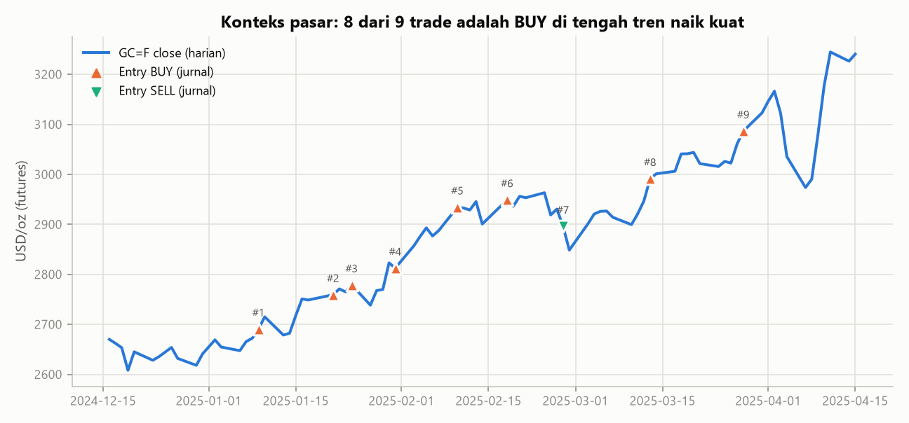
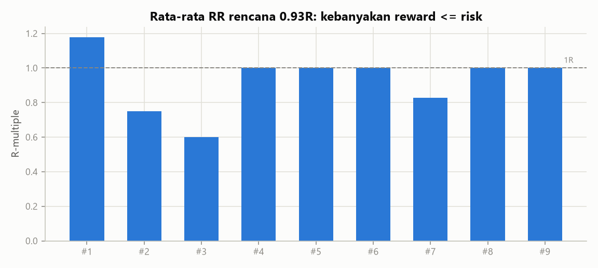

# 01 - Audit Jurnal Manual XAUUSD (Jan-Mar 2025)

*Dibuat otomatis oleh `scripts/run_all.py`. Sumber: `journals/template-backtest.csv` (salinan dari Google Drive
`02_Proyek/Trading/template-backtest.csv`). Data harga pembanding: `GC=F` (Yahoo Finance) harian dan 1 jam.*

## Ringkasan

| Metrik | Nilai |
|---|---|
| Jumlah trade | 9 (8 BUY, 1 SELL) |
| Periode | 09 Jan 2025 - 28 Mar 2025 |
| Win rate tercatat | 100% (9/9) |
| Interval kepercayaan 95% win rate (Wilson) | 70% - 100% |
| RR rencana rata-rata / median / minimum | 0.93R / 1.00R / 0.60R |
| Expectancy realisasi (tanpa biaya) | +0.93R per trade |
| Total R | 8.36R |
| Win rate impas pada RR 0.93 | 51.8% |
| Trade yang dibuka dan ditutup di hari yang sama | 4 |
| Perubahan harga GC=F 1 Jan - 31 Mar 2025 | 17.0% (65% hari naik) |
| Perubahan harga selama rentang jurnal (09 Jan - 28 Mar 2025) | 14.7% |

**Kesimpulan singkat:** angka 9/9 TP terlihat sempurna, tetapi secara statistik belum membuktikan apa pun. Sampelnya terlalu
kecil, hampir semua posisi searah dengan tren naik yang sangat kuat, dan tidak ada satu pun trade rugi yang tercatat.
Rata-rata RR rencana di bawah 1 (0.93R), sehingga sistem ini butuh win rate di atas 52% hanya untuk
impas. Bahkan jika 9 trade ini dianggap sampel acak yang jujur (padahal kemungkinan besar tidak, lihat bagian masalah data),
interval kepercayaan 95% win rate-nya masih 70%-100%: terlalu lebar untuk dijadikan dasar sistem.

## Tabel per trade

R rencana = |TP - entry| / |entry - SL|. R realisasi dihitung dari kolom `Keterangan` (TP berarti exit di TP).
R neto (est.) mengurangi asumsi biaya: spread 0.30 USD, komisi 0.07 USD/oz, dan
slippage entry 0.05 USD. Jurnal tidak mencatat biaya, jadi angka ini hanya perkiraan.

| # | Arah | Entry | Hari | Exit | Hari exit | Harga entry | SL | TP | Risk $ | Reward $ | R rencana | R realisasi | R neto (est.) | Hold (hari) |
|---|---|---|---|---|---|---|---|---|---|---|---|---|---|---|
| 1 | BUY | 09-Jan-2025 | Kamis | 16-Jan-2025 | Kamis | 2675.50 | 2642.00 | 2715.00 | 33.5 | 39.5 | 1.18 | 1.18 | 1.17 | 7 |
| 2 | BUY | 21-Jan-2025 | Selasa | 21-Jan-2025 | Selasa | 2726.50 | 2696.50 | 2749.00 | 30.0 | 22.5 | 0.75 | 0.75 | 0.74 | 0 |
| 3 | BUY | 24-Jan-2025 | Jumat | 30-Jan-2025 | Kamis | 2764.00 | 2724.00 | 2788.00 | 40.0 | 24.0 | 0.60 | 0.60 | 0.59 | 6 |
| 4 | BUY | 31-Jan-2025 | Jumat | 01-Feb-2025 | Sabtu | 2799.50 | 2758.00 | 2841.00 | 41.5 | 41.5 | 1.00 | 1.00 | 0.99 | 1 |
| 5 | BUY | 10-Feb-2025 | Senin | 10-Feb-2025 | Senin | 2868.00 | 2833.00 | 2903.00 | 35.0 | 35.0 | 1.00 | 1.00 | 0.99 | 0 |
| 6 | BUY | 18-Feb-2025 | Selasa | 19-Feb-2025 | Rabu | 2913.00 | 2875.50 | 2950.50 | 37.5 | 37.5 | 1.00 | 1.00 | 0.99 | 1 |
| 7 | SELL | 27-Feb-2025 | Kamis | 28-Feb-2025 | Jumat | 2886.50 | 2924.50 | 2855.00 | 38.0 | 31.5 | 0.83 | 0.83 | 0.82 | 1 |
| 8 | BUY | 13-Mar-2025 | Kamis | 13-Mar-2025 | Kamis | 2941.50 | 2917.50 | 2965.50 | 24.0 | 24.0 | 1.00 | 1.00 | 0.98 | 0 |
| 9 | BUY | 28-Mar-2025 | Jumat | 28-Mar-2025 | Jumat | 3060.50 | 2998.50 | 3122.50 | 62.0 | 62.0 | 1.00 | 1.00 | 0.99 | 0 |

## Masalah data yang ditemukan

1. Trade #4: tanggal exit 01-Feb-2025 jatuh pada hari Sabtu (pasar emas spot/futures tutup pada Sabtu; Minggu hanya buka malam waktu Asia).
2. Semua 9 trade tercatat TP (0 loss). Ini sangat jarang terjadi pada data nyata dan mengindikasikan seleksi/hindsight bias atau trade loss yang tidak dicatat.
3. **Sampel sangat kecil.** Dengan 9 trade, satu trade rugi saja mengubah win rate sebesar 10 poin persen.
   Sebagai patokan kasar, minimal 100 trade dibutuhkan sebelum win rate dan expectancy layak diandalkan.
4. **Bias tren dan arah.** 8 dari 9 trade adalah BUY, sementara emas naik 17.0% pada
   kuartal tersebut. Hasil ini lebih banyak mencerminkan arah pasar (beta) daripada keunggulan setup (alpha).
   Kita tidak tahu bagaimana setup yang sama bekerja saat pasar turun atau sideways.
5. **Kolom penting tidak ada:** jam entry/exit, ukuran lot, risk %, spread/biaya, MAE/MFE, alasan entry,
   dan screenshot. Tanpa jam, urutan SL vs TP tidak bisa diverifikasi untuk trade yang dibuka dan ditutup di hari yang sama.
6. **RR < 1 pada 3 trade** (RR terendah 0.60). Struktur ini rawan.
   Satu kali SL menghapus profit dari 1-2 trade TP.
7. **Risiko hindsight bias.** Jurnal backtest manual yang dibuat dengan melihat chart historis cenderung memilih
   setup yang "jelas" setelah hasilnya diketahui. Aturan entry perlu ditulis sebelum melihat data.

## Verifikasi kasar terhadap data harga (GC=F 1 jam)

Data pembanding adalah **futures COMEX**, bukan spot broker, dan jurnal tidak memuat jam. Karena itu harga entry jurnal
dibandingkan dengan range futures pada hari yang sama, lalu level entry/TP/SL digeser oleh selisih median futures-spot
(32.00 USD) untuk melihat level mana yang tersentuh lebih dulu.
Hasilnya **indikatif saja**.

| # | Entry di range futures hari itu? | Futures - entry jurnal ($) | Level pertama tersentuh (futures, digeser basis) |
|---|---|---|---|
| 1 | Ya | 17.8 | SL |
| 2 | Ya | 31.9 | belum tersentuh s.d. tanggal exit |
| 3 | Ya | 13.5 | TP |
| 4 | Tidak | 32.0 | belum tersentuh s.d. tanggal exit |
| 5 | Tidak | 75.2 | TP |
| 6 | Tidak | 40.3 | belum tersentuh s.d. tanggal exit |
| 7 | Ya | -0.3 | TP |
| 8 | Tidak | 57.2 | TP |
| 9 | Tidak | 57.5 | belum tersentuh s.d. tanggal exit |

Ringkasan: hanya **4 dari 9** trade yang TP-nya dapat dikonfirmasi tersentuh lebih dulu dengan data
futures. SL lebih dulu = 1, ambigu (keduanya dalam 1 bar) = 0, belum tersentuh/tidak dapat diverifikasi = 4. Selisih futures terhadap spot pada awal 2025 sempat melebar tidak biasa (puluhan USD), sehingga
pergeseran satu angka median tidak akurat untuk semua trade. Jika ada trade yang menurut data futures terkena SL lebih
dulu, cek ulang di chart broker (MT5) dengan timeframe M15/M5.

## Rekomendasi

1. Catat **semua** trade, termasuk yang rugi dan yang dibatalkan, menggunakan `templates/jurnal_trading_v2.csv`
   (lengkap dengan jam, lot, risk %, spread, MAE/MFE, dan screenshot).
2. Tulis aturan setup secara tertulis **sebelum** backtest manual berikutnya, lalu uji pada periode turun/sideways
   (misalnya 2022 atau Q2 2013) agar bias tren terlihat.
3. Targetkan RR rencana >= 1.5 atau buktikan dengan data bahwa win rate > 52% bisa dipertahankan.
4. Kumpulkan >= 100 trade, lalu hitung ulang dengan `trading_research.journal.load_v2` dan `v2_summary`.
