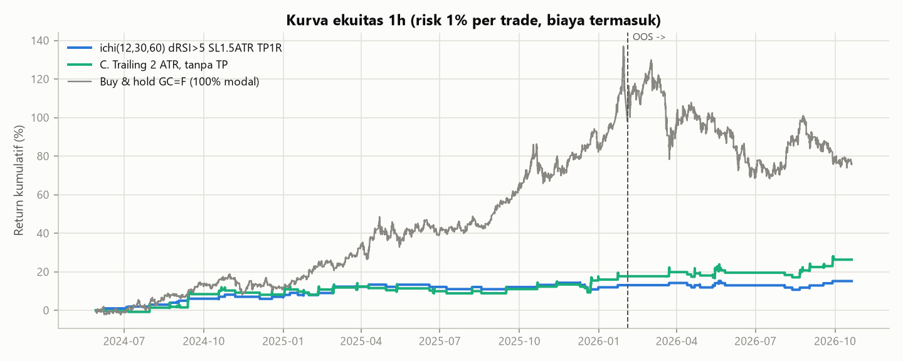
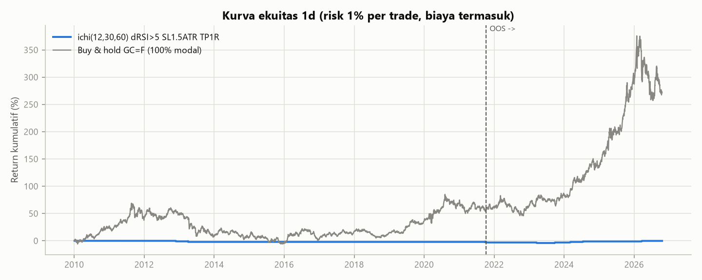
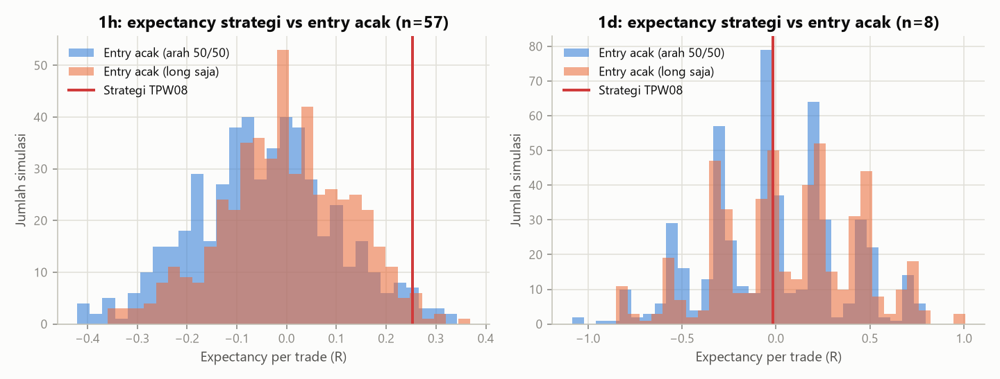
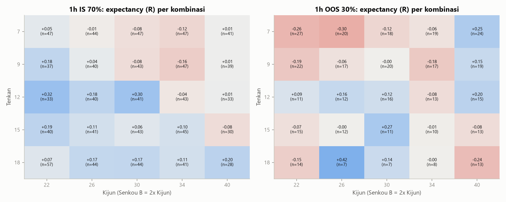
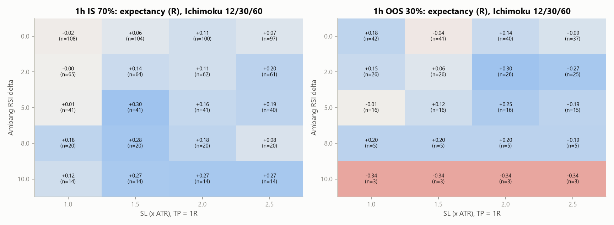
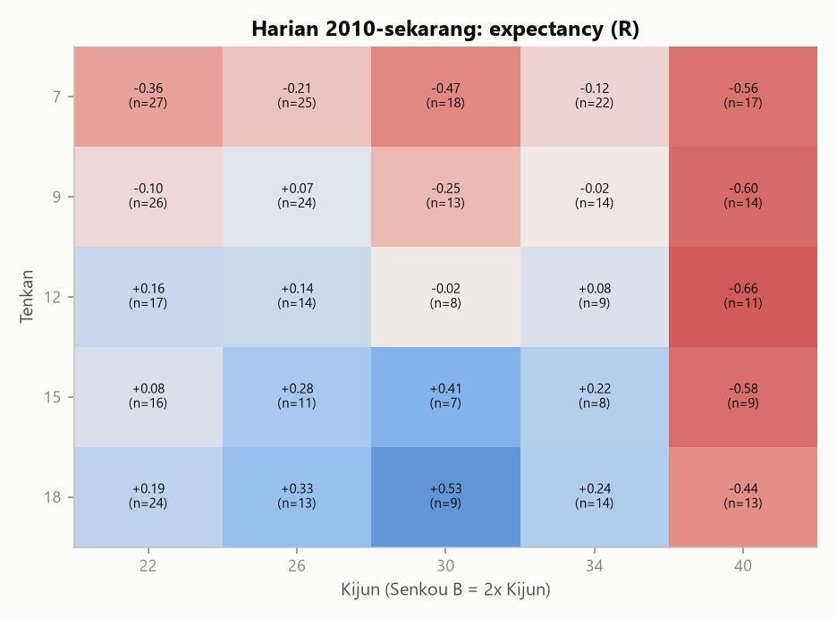
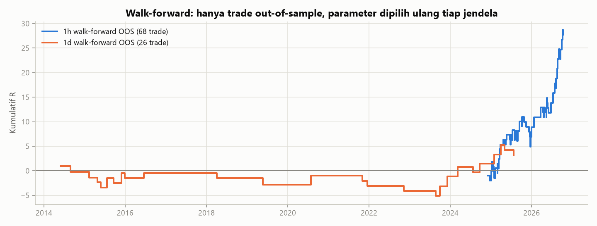
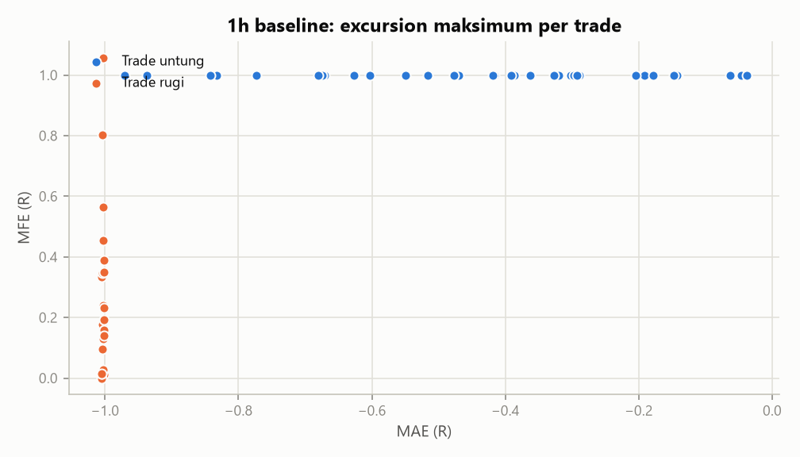
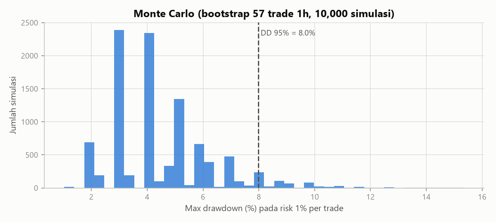

# 02 - Rekonstruksi dan Validasi Strategi Ichimoku-RSI (XAUUSD)

*Dibuat otomatis oleh `scripts/run_all.py`. Semua angka berasal dari run ini. Data: Yahoo Finance `GC=F`
(spot `XAUUSD=X` tidak tersedia di Yahoo). Modal awal 10,000 USD, risk 1% equity per trade.*

## TL;DR

**Edge BELUM TERBUKTI (bukti campuran).** 3 dari 6 kriteria validasi lulus. Ada sinyal positif pada data 1h 2024-2026, tetapi tidak konsisten di semua uji dan hanya berasal dari satu regime pasar (tren naik emas).

Angka klaim TPW08 (WR 65%, PF 1.85) hanya muncul **in-sample** (1h IS: WR 65.9%, PF 1.83). Di out-of-sample turun ke WR 56.2% / PF 1.26, dan walk-forward 1h WR 48.5%.

* **1h (2024-05-29 - 2026-10-20), parameter TPW08:** in-sample 41 trade,
  WR 65.9%, expectancy +0.30R. Out-of-sample 16 trade,
  WR 56.2%, expectancy +0.12R (CI95 -0.38R .. +0.62R).
* **Walk-forward 1h:** 68 trade OOS, expectancy +0.41R, p = 0.013.
* **Harian 2010-sekarang:** aturan TPW08 hanya menghasilkan **8 trade dalam ~17 tahun**,
  dengan expectancy -0.02R. Ini satu-satunya data yang benar-benar independen dari periode
  "optimasi" TPW08 (2024-2026).
* **Pembanding:** buy & hold emas selama periode 1h memberi 76.0% (MaxDD 29.0%),
  sedangkan strategi pada risk 1% memberi 15.2% (MaxDD 4.2%).
* **Multiple testing:** laporan ini mencoba 147 konfigurasi. Nilai p yang tidak dikoreksi akan terlihat lebih
  bagus dari kenyataannya.

## 1. Aturan yang diekstrak dari dokumen TPW08

| Aspek | Isi dokumen | Implementasi di repo |
|---|---|---|
| Instrumen / timeframe | XAUUSD, M15, backtest 24 bulan (2024-2026), >200 trade | 1h (~2,4 tahun) dan harian (2010-sekarang). M15 Yahoo hanya 60 hari (lihat bagian 9) |
| Ichimoku | Parameter "dioptimasi" ke (12, 30, 60) | Tenkan 12, Kijun 30, Senkou B 60, displacement 30 |
| Filter tren | Buy hanya di atas Kumo, Sell hanya di bawah Kumo | `close > max(SpanA, SpanB)` / `close < min(...)` (awan yang sudah digeser = kausal) |
| Trigger | Tenkan memotong Kijun | Cross terjadi di bar yang sama dengan sinyal |
| Momentum | RSI(14), `RSI_t - RSI_t-1 > threshold` (contoh 5) | Ambang 5. Untuk short memakai cermin `< -5` (**asumsi**) |
| Stop loss / take profit | Tidak disebut | **Asumsi:** SL = 1,5 x ATR(14), TP = 1R. WR 65% + PF 1,85 menyiratkan payoff ~1,0 |
| ATR | `ATR = SMA(TR, n)` | ATR SMA 14 (sama dengan iATR di MT5) |
| Position sizing | Risk 1% equity / jarak SL | Risk 1% equity / jarak SL (unit fraksional) |
| Trailing stop (UAS) | `TS = harga - k x ATR` | Diperbarui di close bar, aktif bar berikutnya, hanya bergerak searah profit |
| Eksekusi | MT5, verifikasi latensi tick | Sinyal di close bar t, eksekusi di open bar t+1 |

## 2. Model eksekusi dan biaya

* Harga Yahoo dianggap harga **mid**. Spread 0.30 USD (beli di ask, jual di bid), slippage
  0.05 USD per order market/stop, komisi 7 USD per lot round-turn,
  swap 5%/tahun (long) dan 1%/tahun (short) dari nilai nosional.
* SL/TP diperiksa terhadap high/low bar. **Jika SL dan TP tersentuh di bar yang sama, SL dianggap lebih dulu** (konservatif).
  Gap melewati SL diisi di harga open.
* Median jarak SL saat entry: harian 37.48 USD, 1h 18.14 USD, 15m 10.52 USD.
  Biaya round-trip (~0.47 USD) setara
  ~2.6% R di 1h dan
  ~4.5% R di 15m.

## 3. Hasil baseline (parameter TPW08), split kronologis IS 70% / OOS 30%

| TF | Segmen | Periode | Trade (L/S) | Win rate | Expectancy | CI95 expectancy | p (E>0) | PF | MaxDD | CAGR | Sharpe | E long | E short | MAE/MFE rata2 |
|---|---|---|---|---|---|---|---|---|---|---|---|---|---|---|
| 1d | ALL | 2010-01-04 - 2026-10-20 | 8 (4/4) | 50.0% | -0.02R | -0.77R .. +0.73R | 0.516 | 0.96 | 4.3% | -0.0% | -0.01 | -0.02R | -0.01R | -0.68 / 0.75 |
| 1d | IS 70% | 2010-01-04 - 2021-10-05 | 3 (1/2) | 0.0% | -0.83R | -1.03R .. -0.45R | 0.976 | 0.00 | 2.6% | -0.2% | -0.40 | -1.03R | -0.73R | -0.90 / 0.50 |
| 1d | OOS 30% | 2021-10-06 - 2026-10-20 | 5 (3/2) | 80.0% | +0.59R | -0.21R .. +0.99R | 0.107 | 3.93 | 1.3% | 0.6% | 0.73 | +0.32R | +0.99R | -0.48 / 0.90 |
| 1h | ALL | 2024-05-29 - 2026-10-20 | 57 (30/27) | 63.2% | +0.25R | +0.01R .. +0.50R | 0.027 | 1.64 | 4.2% | 6.1% | 1.10 | +0.19R | +0.33R | -0.63 / 0.73 |
| 1h | IS 70% | 2024-05-29 - 2026-02-03 | 41 (25/16) | 65.9% | +0.30R | +0.01R .. +0.60R | 0.024 | 1.83 | 4.2% | 7.6% | 1.30 | +0.26R | +0.37R | -0.61 / 0.73 |
| 1h | OOS 30% | 2026-02-03 - 2026-10-20 | 16 (5/11) | 56.2% | +0.12R | -0.38R .. +0.62R | 0.323 | 1.26 | 4.0% | 2.6% | 0.55 | -0.21R | +0.27R | -0.69 / 0.74 |
| 15m | ALL | 2026-08-11 - 2026-10-20 | 17 (9/8) | 52.9% | +0.05R | -0.42R .. +0.52R | 0.425 | 1.09 | 3.5% | 3.9% | 0.45 | -0.12R | +0.24R | -0.74 / 0.75 |
| 15m | IS 70% | 2026-08-11 - 2026-09-29 | 12 (7/5) | 58.3% | +0.16R | -0.35R .. +0.66R | 0.304 | 1.36 | 1.8% | 14.5% | 1.64 | +0.13R | +0.19R | -0.67 / 0.74 |
| 15m | OOS 30% | 2026-09-29 - 2026-10-20 | 5 (2/3) | 40.0% | -0.21R | -1.02R .. +0.59R | 0.657 | 0.64 | 2.8% | -17.5% | -1.72 | -1.02R | +0.32R | -0.90 / 0.78 |

### Perbandingan dengan klaim TPW08

| Metrik | Klaim TPW08 (M15 2024-2026) | 1h IS | 1h OOS | 1h walk-forward OOS | Harian 2010-sekarang |
|---|---|---|---|---|---|
| Win rate | 65% | 65.9% | 56.2% | 48.5% | 50.0% |
| Profit factor | 1.85 | 1.83 | 1.26 | - | 0.96 |
| Max drawdown | 15% (risk/trade tidak disebut) | 4.2% | 4.0% | 5.9% | 4.3% |
| Jumlah trade | >200 / 24 bulan | 41 | 16 | 68 | 8 |
| Expectancy per trade | tidak dilaporkan | +0.30R | +0.12R | +0.41R | -0.02R |

Catatan: drawdown bergantung pada risk per trade, yang tidak disebutkan di TPW08. Dengan sampel trade 1h di atas,
risk per trade yang dibutuhkan agar DD Monte Carlo persentil 95 mencapai 15% adalah sekitar **2.00%**.

## 4. Apakah lebih baik dari entry acak?

Model nol: exit tetap sama (SL 1,5 ATR, TP 1R, biaya sama), tetapi bar entry dipilih acak dengan jumlah trade yang sama
(500 simulasi). Versi "long saja" mengukur seberapa besar hasil yang hanya berasal dari tren naik emas.

| TF | Expectancy strategi | Mean acak (50/50) | Persentil 95 acak | p empiris | Mean acak long | Persentil 95 long | p empiris long |
|---|---|---|---|---|---|---|---|
| 1h | +0.25R | -0.04R | +0.21R | 0.028 | -0.00R | +0.20R | 0.018 |
| 1d | -0.02R | -0.02R | +0.52R | 0.447 | +0.07R | +0.69R | 0.557 |

## 5. Robustness parameter (grid kecil) dan tanda overfitting

* Grid Tenkan x Kijun di 1h: 72% sel positif di IS dan 36% sel positif di OOS.
  Korelasi peringkat (Spearman) IS vs OOS = **0.23** (n = 25 sel dengan >= 5 trade).
  Nilai mendekati 0 atau negatif berarti parameter terbaik di masa lalu **tidak** memprediksi yang terbaik di masa depan.
* Kombinasi terbaik di IS: `ichi(12,22,44) dRSI>5 SL1.5ATR TP1R` dengan expectancy IS +0.32R, lalu
  +0.09R di OOS (11 trade). Sel TPW08 (12/30) di OOS: +0.12R (16 trade).
* Grid ambang RSI delta x SL (ATR): Spearman IS vs OOS = 0.43 (n = 16).
* Harian: 48% sel positif, median hanya 14 trade per sel
  sejak 2010. Terlalu sedikit untuk kesimpulan apa pun.

## 6. Walk-forward

Grid 72 kombinasi (Tenkan [9, 12], Kijun [26, 30], RSI delta [0.0, 3.0, 5.0],
SL [1.0, 1.5, 2.0] ATR, TP [1.0, 2.0]R). Parameter dengan expectancy tertinggi di jendela latih dipakai
pada jendela uji berikutnya, lalu jendela digeser.

### Walk-forward 1h (6 bulan latih / 2 bulan uji, minimal 10 trade di data latih)

Hasil gabungan OOS: **68 trade, win rate 48.5%, expectancy +0.41R**
(CI95 +0.07R .. +0.76R, p = 0.013), MaxDD pada risk 1%: 5.9%.

Detail per jendela

| # | Latih mulai | Uji mulai | Uji selesai | Parameter terpilih | Trade IS | E IS | Trade OOS | E OOS |
|---|---|---|---|---|---|---|---|---|
| 0 | 2024-05-29 | 2024-11-29 | 2025-01-29 | ichi(12,30,60) dRSI>3 SL2ATR TP2R | 13 | +0.82R | 7 | -0.07R |
| 1 | 2024-07-29 | 2025-01-29 | 2025-03-29 | ichi(12,30,60) dRSI>3 SL2ATR TP2R | 16 | +0.70R | 9 | +0.65R |
| 2 | 2024-09-29 | 2025-03-29 | 2025-05-29 | ichi(9,30,60) dRSI>5 SL2ATR TP1R | 13 | +0.37R | 4 | +0.49R |
| 3 | 2024-11-29 | 2025-05-29 | 2025-07-29 | ichi(9,30,60) dRSI>5 SL2ATR TP2R | 13 | +0.59R | 5 | +0.19R |
| 4 | 2025-01-29 | 2025-07-29 | 2025-09-29 | ichi(9,30,60) dRSI>5 SL2ATR TP2R | 13 | +0.83R | 7 | +0.26R |
| 5 | 2025-03-29 | 2025-09-29 | 2025-11-29 | ichi(9,30,60) dRSI>3 SL2ATR TP2R | 19 | +0.52R | 4 | -0.28R |
| 6 | 2025-05-29 | 2025-11-29 | 2026-01-29 | ichi(12,30,60) dRSI>3 SL1.5ATR TP2R | 12 | +0.49R | 7 | +0.28R |
| 7 | 2025-07-29 | 2026-01-29 | 2026-03-29 | ichi(12,30,60) dRSI>5 SL1.5ATR TP2R | 12 | +0.74R | 1 | +2.00R |
| 8 | 2025-09-29 | 2026-03-29 | 2026-05-29 | ichi(12,30,60) dRSI>5 SL1.5ATR TP2R | 10 | +0.79R | 9 | -0.01R |
| 9 | 2025-11-29 | 2026-05-29 | 2026-07-29 | ichi(12,26,52) dRSI>3 SL1ATR TP2R | 12 | +0.29R | 4 | +1.24R |
| 10 | 2026-01-29 | 2026-07-29 | 2026-09-29 | ichi(12,26,52) dRSI>3 SL1ATR TP2R | 12 | +0.74R | 9 | +0.99R |
| 11 | 2026-03-29 | 2026-09-29 | 2026-10-20 | ichi(12,26,52) dRSI>3 SL1ATR TP2R | 20 | +0.94R | 2 | +0.49R |

### Walk-forward 1d (4 tahun latih / 1 tahun uji, minimal 5 trade di data latih)

Hasil gabungan OOS: **26 trade, win rate 42.3%, expectancy +0.12R**
(CI95 -0.39R .. +0.69R, p = 0.333), MaxDD pada risk 1%: 6.1%.

Detail per jendela

| # | Latih mulai | Uji mulai | Uji selesai | Parameter terpilih | Trade IS | E IS | Trade OOS | E OOS |
|---|---|---|---|---|---|---|---|---|
| 0 | 2010-01-04 | 2014-01-04 | 2015-01-04 | ichi(9,26,52) dRSI>5 SL1ATR TP1R | 6 | +0.77R | 2 | -0.11R |
| 1 | 2011-01-04 | 2015-01-04 | 2016-01-04 | ichi(9,26,52) dRSI>0 SL2ATR TP2R | 11 | +0.57R | 7 | -0.19R |
| 2 | 2012-01-04 | 2016-01-04 | 2017-01-04 | ichi(12,26,52) dRSI>3 SL1ATR TP1R | 8 | +0.58R | 1 | +1.00R |
| 3 | 2013-01-04 | 2017-01-04 | 2018-01-04 | ichi(9,30,60) dRSI>3 SL1ATR TP2R | 7 | +1.11R | 0 | n/a |
| 4 | 2014-01-04 | 2018-01-04 | 2019-01-04 | ichi(9,30,60) dRSI>3 SL1ATR TP2R | 5 | +1.36R | 1 | -1.01R |
| 5 | 2015-01-04 | 2019-01-04 | 2020-01-04 | ichi(9,30,60) dRSI>3 SL1ATR TP2R | 6 | +0.96R | 1 | -1.29R |
| 6 | 2016-01-04 | 2020-01-04 | 2021-01-04 | ichi(12,30,60) dRSI>0 SL2ATR TP2R | 5 | +0.72R | 1 | +1.87R |
| 7 | 2017-01-04 | 2021-01-04 | 2022-01-04 | ichi(9,26,52) dRSI>3 SL1.5ATR TP1R | 6 | +0.62R | 2 | -1.08R |
| 8 | 2018-01-04 | 2022-01-04 | 2023-01-04 | ichi(9,26,52) dRSI>3 SL2ATR TP2R | 6 | +0.50R | 1 | -1.02R |
| 9 | 2019-01-04 | 2023-01-04 | 2024-01-04 | ichi(12,26,52) dRSI>0 SL1.5ATR TP2R | 6 | +0.94R | 3 | +0.98R |
| 10 | 2020-01-04 | 2024-01-04 | 2025-01-04 | ichi(12,26,52) dRSI>0 SL1.5ATR TP2R | 8 | +1.21R | 3 | +0.90R |
| 11 | 2021-01-04 | 2025-01-04 | 2026-01-04 | ichi(12,26,52) dRSI>3 SL1ATR TP2R | 5 | +1.33R | 4 | +0.43R |
| 12 | 2022-01-04 | 2026-01-04 | 2026-10-20 | ichi(9,26,52) dRSI>5 SL1ATR TP2R | 5 | +1.32R | 0 | n/a |

## 7. Varian ATR trailing stop (proposal UAS)

| TF | Varian | Segmen | Trade | Win rate | Expectancy | PF | MaxDD | MFE rata2 |
|---|---|---|---|---|---|---|---|---|
| 1h | A. Baseline: SL 1.5 ATR, TP 1R | IS | 41 | 65.9% | +0.30R | 1.83 | 4.2% | 0.73 |
| 1h | A. Baseline: SL 1.5 ATR, TP 1R | OOS | 16 | 56.2% | +0.12R | 1.26 | 4.0% | 0.74 |
| 1h | B. Trailing 1.5 ATR, tanpa TP | IS | 41 | 48.8% | +0.52R | 2.39 | 4.6% | 1.91 |
| 1h | B. Trailing 1.5 ATR, tanpa TP | OOS | 16 | 43.8% | +0.28R | 1.58 | 5.0% | 1.71 |
| 1h | C. Trailing 2 ATR, tanpa TP | IS | 41 | 43.9% | +0.41R | 1.91 | 5.0% | 2.06 |
| 1h | C. Trailing 2 ATR, tanpa TP | OOS | 16 | 50.0% | +0.46R | 1.91 | 5.4% | 2.32 |
| 1h | D. Trailing 3 ATR, tanpa TP | IS | 40 | 42.5% | +0.52R | 1.90 | 7.4% | 2.58 |
| 1h | D. Trailing 3 ATR, tanpa TP | OOS | 15 | 40.0% | +0.22R | 1.39 | 6.7% | 2.37 |
| 1h | E. Trailing 2 ATR + TP 2R | IS | 41 | 43.9% | +0.44R | 1.99 | 4.0% | 1.25 |
| 1h | E. Trailing 2 ATR + TP 2R | OOS | 16 | 50.0% | +0.40R | 1.80 | 4.0% | 1.23 |
| 1d | A. Baseline: SL 1.5 ATR, TP 1R | IS | 3 | 0.0% | -0.83R | 0.00 | 2.6% | 0.50 |
| 1d | A. Baseline: SL 1.5 ATR, TP 1R | OOS | 5 | 80.0% | +0.59R | 3.93 | 1.3% | 0.90 |
| 1d | B. Trailing 1.5 ATR, tanpa TP | IS | 3 | 0.0% | -0.74R | 0.00 | 2.2% | 0.50 |
| 1d | B. Trailing 1.5 ATR, tanpa TP | OOS | 5 | 40.0% | +0.52R | 3.08 | 1.4% | 2.21 |
| 1d | C. Trailing 2 ATR, tanpa TP | IS | 3 | 0.0% | -0.83R | 0.00 | 2.6% | 0.50 |
| 1d | C. Trailing 2 ATR, tanpa TP | OOS | 5 | 40.0% | +1.19R | 3.94 | 3.8% | 3.62 |
| 1d | D. Trailing 3 ATR, tanpa TP | IS | 3 | 0.0% | -0.83R | 0.00 | 2.6% | 0.50 |
| 1d | D. Trailing 3 ATR, tanpa TP | OOS | 5 | 40.0% | +0.79R | 2.19 | 5.6% | 3.65 |
| 1d | E. Trailing 2 ATR + TP 2R | IS | 3 | 0.0% | -0.83R | 0.00 | 2.6% | 0.50 |
| 1d | E. Trailing 2 ATR + TP 2R | OOS | 5 | 60.0% | +0.89R | 3.98 | 1.4% | 1.58 |

Bandingkan kolom MaxDD dan Expectancy per segmen. Klaim UAS bahwa trailing ATR "menurunkan DD dari 15% ke <10%"
hanya bermakna jika diukur pada risk per trade yang sama. Di sini semua varian memakai risk 1%.

## 8. Monte Carlo drawdown (bootstrap urutan trade)

| Sampel trade | n | Risk/trade | DD historis | DD median | DD 95% | DD 99% | P(rugi setelah n trade) |
|---|---|---|---|---|---|---|---|
| 1h baseline (semua trade) | 57 | 0.5% | 2.0% | 2.0% | 4.1% | 5.4% | 2.4% |
| 1h baseline (semua trade) | 57 | 1% | 4.0% | 4.1% | 8.0% | 10.6% | 2.6% |
| 1h baseline (semua trade) | 57 | 2% | 7.9% | 8.0% | 15.5% | 20.2% | 4.2% |
| 1h walk-forward OOS | 68 | 0.5% | 3.0% | 3.0% | 5.5% | 7.1% | 0.9% |
| 1h walk-forward OOS | 68 | 1% | 5.9% | 6.0% | 10.7% | 13.7% | 0.9% |
| 1h walk-forward OOS | 68 | 2% | 11.6% | 11.7% | 20.4% | 25.9% | 1.1% |

## 9. Sensitivitas biaya (spread)

| TF | Spread (USD) | Trade | Expectancy | PF | Win rate |
|---|---|---|---|---|---|
| 1h | 0.0 | 57 | +0.254R | 1.64 | 63.2% |
| 1h | 0.2 | 57 | +0.254R | 1.64 | 63.2% |
| 1h | 0.3 | 57 | +0.253R | 1.64 | 63.2% |
| 1h | 0.4 | 57 | +0.253R | 1.64 | 63.2% |
| 1h | 0.8 | 57 | +0.182R | 1.43 | 59.6% |
| 1h | 2.0 | 57 | +0.146R | 1.33 | 57.9% |
| 15m | 0.0 | 17 | +0.048R | 1.09 | 52.9% |
| 15m | 0.2 | 17 | +0.048R | 1.09 | 52.9% |
| 15m | 0.3 | 17 | +0.048R | 1.09 | 52.9% |
| 15m | 0.4 | 17 | +0.048R | 1.09 | 52.9% |
| 15m | 0.8 | 17 | +0.048R | 1.09 | 52.9% |
| 15m | 2.0 | 17 | -0.188R | 0.68 | 41.2% |

Karena SL dan TP dipasang relatif terhadap harga fill (seperti di MT5), biaya tidak mengurangi R secara langsung.
Biaya mengubah **peluang** SL vs TP tersentuh (TP butuh gerakan harga lebih jauh, SL lebih dekat). Dengan SL ~18 USD di 1h,
spread 0,2-0,4 USD hampir tidak berpengaruh; spread 2 USD (kondisi berita) mulai menggerus expectancy.

Data 15m Yahoo hanya mencakup ~60 hari terakhir (2026-08-11 - 2026-10-20, 17 trade).
Data ini paling dekat dengan timeframe TPW08 (M15), tetapi terlalu pendek untuk kesimpulan.

## 10. Kriteria validasi edge

| Kriteria | Hasil |
|---|---|
| OOS 1h: batas bawah CI95 expectancy > 0 | GAGAL |
| Walk-forward 1h: expectancy OOS > 0 dengan p < 0.05 | LULUS |
| Mengalahkan 95% entry acak (1h) | LULUS |
| Mengalahkan 95% entry acak long-only (1h) | LULUS |
| Harian 2010-sekarang: >= 30 trade dan expectancy > 0 | GAGAL |
| Peringkat IS dan OOS di grid berkorelasi positif (Spearman > 0.3) | GAGAL |

## 11. Kesimpulan

**Edge BELUM TERBUKTI (bukti campuran).** 3 dari 6 kriteria validasi lulus. Ada sinyal positif pada data 1h 2024-2026, tetapi tidak konsisten di semua uji dan hanya berasal dari satu regime pasar (tren naik emas).

1. **Frekuensi sinyal.** Aturan entry TPW08 menghasilkan 57 trade dalam ~2,4 tahun di 1h, jauh dari ">200 trade per 24 bulan". Di data 15m (60 hari) ada 17 trade, setara ~177 trade per 24 bulan, jadi klaim jumlah trade masuk akal untuk M15, tetapi sampel 15m terlalu pendek untuk menilai kualitasnya.
2. **In-sample vs out-of-sample.** Angka klaim TPW08 (WR 65%, PF 1.85) hanya muncul **in-sample** (1h IS: WR 65.9%, PF 1.83). Di out-of-sample turun ke WR 56.2% / PF 1.26, dan walk-forward 1h WR 48.5%. Parameter (12, 30, 60) menurut dokumen sudah "dioptimasi" pada 2024-2026, periode yang sama dengan seluruh data 1h. Jadi segmen OOS di sini pun belum sepenuhnya independen dari pemilihan parameter TPW08.
3. **Data independen (harian 2010-sekarang).** Aturan TPW08 hanya memberi 8 trade (expectancy -0.02R). Walk-forward harian: 26 trade, expectancy +0.12R, p = 0.333, artinya tidak berbeda signifikan dari nol.
4. **Temuan paling menjanjikan: 1h.** Strategi mengungguli entry acak (p empiris 0.028; long-only 0.018) dan walk-forward 1h positif (+0.41R, p = 0.013). Namun data hanya ~2,4 tahun dalam satu regime, p-value belum dikoreksi atas 147 konfigurasi, dan segmen OOS 30% saja (16 trade) tidak berbeda signifikan dari nol.
5. **Trailing ATR (proposal UAS).** Varian C (trailing 2 ATR, tanpa TP) di 1h: expectancy IS/OOS +0.41R/+0.46R vs baseline +0.30R/+0.12R; MaxDD 5.0%/5.4% vs 4.2%/4.0%. Trailing meningkatkan expectancy dan tidak menurunkan drawdown. Drawdown terutama ditentukan oleh **risk per trade**: pada risk 1%, DD Monte Carlo persentil 95 = 8.0%, sedangkan DD 15% setara risk sekitar 2.00% per trade.

## 12. Keterbatasan

* **Futures vs spot broker.** `GC=F` adalah kontrak futures COMEX bulan terdekat (continuous). Harganya berbeda dari
  XAUUSD spot/CFD di broker MT5: ada basis/contango, lonjakan saat pergantian kontrak (roll), jam sesi yang berbeda,
  dan candle harian yang dipotong pada jam berbeda (server MT5 umumnya GMT+2/+3).
* **Kualitas dan panjang data Yahoo.** Data 1h hanya ~730 hari, 15m hanya 60 hari. Tidak ada data tick, sehingga urutan
  harga di dalam bar tidak diketahui (diasumsikan konservatif). Yahoo bukan sumber data resmi dan bisa direvisi.
* **Biaya disederhanakan.** Spread dianggap konstan, padahal saat berita/rollover bisa melebar beberapa kali lipat.
  Swap dihitung proporsional waktu, tidak mengikuti jadwal rollover dan triple-swap broker.
* **Rekonstruksi aturan.** SL/TP, perlakuan short, dan definisi cross tidak dijelaskan dokumen. Hasil bisa berbeda dari
  kode asli TPW08 (yang tidak tersedia di repo ini).
* **Regime tunggal.** Periode 1h (2024-2026) didominasi tren naik emas yang kuat. Kinerja di regime sideways/turun tidak teruji.
* **Multiple testing.** 147 konfigurasi diuji. Tanpa koreksi (mis. Bonferroni atau deflated Sharpe),
  sebagian hasil "signifikan" kemungkinan hanya kebetulan.
* **Ukuran lot fraksional.** Simulasi memakai unit fraksional. Di akun kecil, pembulatan ke 0,01 lot bisa membuat risk
  aktual berbeda dari 1%.

## 13. Langkah berikutnya

1. Ekspor data M15 XAUUSD dari broker MT5 (2020-sekarang) dan jalankan ulang pipeline ini. Paket `trading_research`
   menerima DataFrame OHLC apa pun.
2. **Bekukan aturan** (parameter, SL/TP, filter) sebelum melihat data baru. Jangan mengoptimasi ulang setelah melihat hasil OOS.
3. Paper trading di akun demo MT5 minimal 3 bulan atau 50 trade, catat di `templates/jurnal_trading_v2.csv`, lalu
   bandingkan expectancy live dengan backtest.
4. Gunakan risk kecil (0,25-0,5%) jika nanti live. Target "3 miliar dalam 3 tahun" (CAGR ~130%) tidak didukung oleh data ini.
